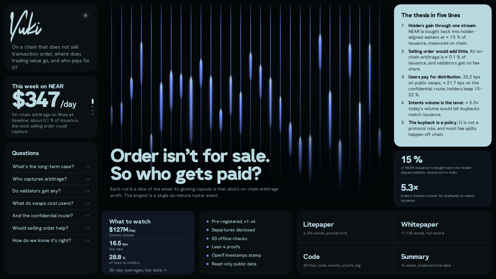
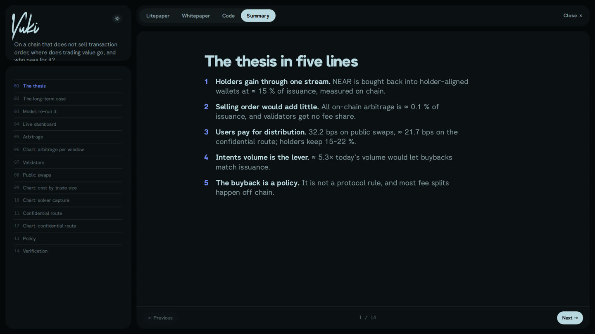
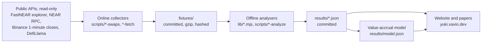
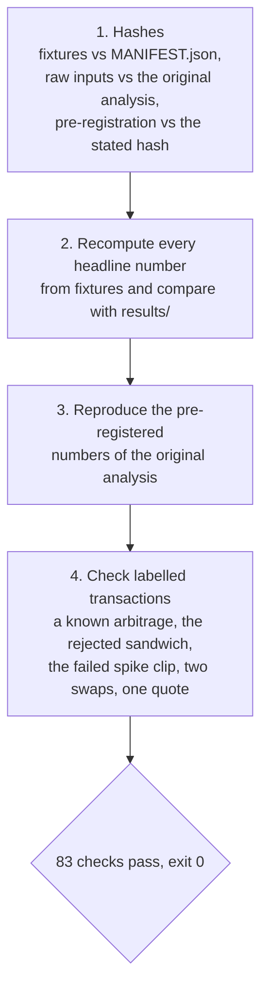
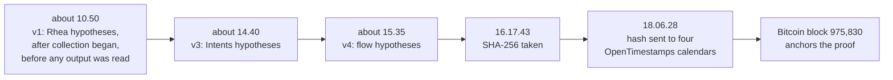
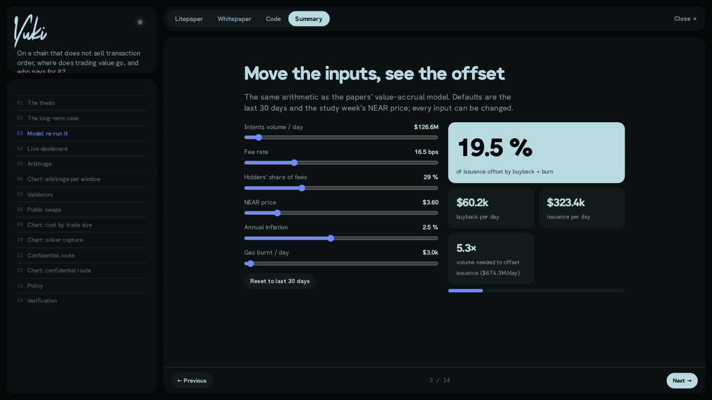
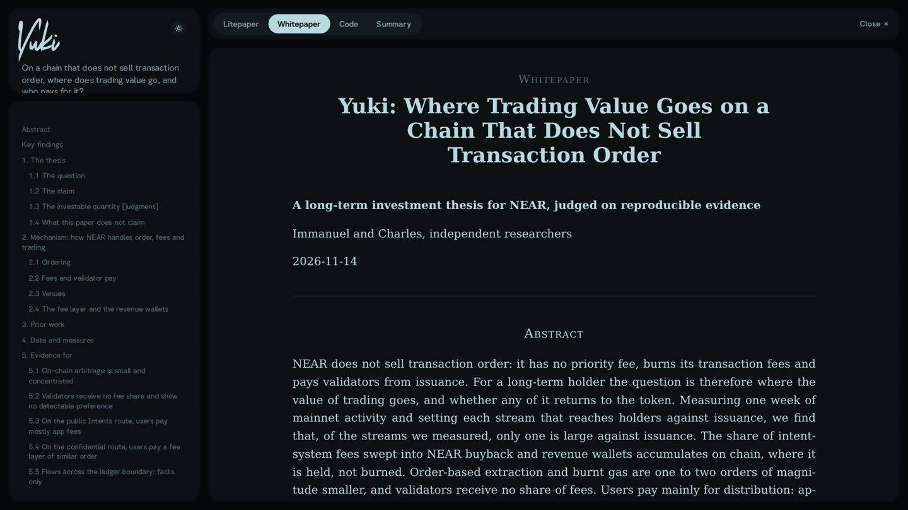

<div align="center">
<picture>
  <source media="(prefers-color-scheme: dark)" srcset="./web/public/yuki-wordmark-ice.svg" />
  
</picture>

# Yuki

### **NEAR does not sell transaction order. We measured where trading value goes instead, and who pays for it.**

<br>

[](https://yuki.xavio.dev)
[](./LICENSE)
[](./fixtures)
[](#for-reviewers-verify-in-ten-minutes)
[](./lean/Yuki/Claims.lean)
[](#reproduce)
[](#pre-registration)

<br>

**[Live site](https://yuki.xavio.dev)** · **[Verify](#for-reviewers-verify-in-ten-minutes)** · **[Findings](#findings)** · **[Method](#method)** · **[Pre-registration](#pre-registration)** · **[Agent-readable](#live-site-and-agent-readable-files)** · **[Reproduce](#reproduce)** · **[Where it lives](#where-it-lives)** · **[Limits](#limits-and-open-questions)** · **[Licence](#licence)**

<br><br>
</div>

**Hosted demo: [yuki.xavio.dev](https://yuki.xavio.dev)**, with the papers, the summary deck, the re-runnable model and a live dashboard.

**Yuki** is a long-term investment thesis for NEAR, built from one week of public mainnet data. NEAR has no priority fee: it burns transaction fees and pays validators from issuance, so nobody can buy a place in a block. On most chains the value of ordering trades goes to whoever sells that place. Here we follow where it goes instead, across the on-chain exchange Rhea, both routes of NEAR Intents, the validators, and the wallets that buy NEAR back. We then set every stream that reaches holders against NEAR's issuance.

The result is two papers, a **[litepaper](./PAPER.md)** in journal form and a **[whitepaper](./WHITEPAPER.md)** with the full record, both by Immanuel and Charles, independent researchers. They come with a value-accrual model you can re-run, offline checks that recompute every number from stored data, machine-checked algebra in Lean 4, and a pre-registration timestamped in Bitcoin.

> ### ⚠️ Scope: one week, read-only, not investment advice
> We measured NEAR mainnet blocks 223,455,000 to 224,500,000 (2026-11-07 to 2026-11-14), through 168 evenly spaced windows of 600 blocks scaled to the week. Value-accrual inputs cover the 30 days to 2026-11-14. We did **not** measure what happens off the public chain: how the confidential route's cost splits between fees and solvers, or how DefiLlama builds its Intents volume. We make **no claim** about users leaving or joining NEAR. Every factual claim carries a label: **[measured]** from our data, **[secondary]** from a named outside source, **[judgment]** our reading, **[to verify]** open. This is research, not financial advice.

<p align="center"></p>

---

## For reviewers: verify in ten minutes

You need Node 20 or newer and nothing else: no install, no network. Every result is recomputed from the committed fixtures and compared with the committed results.

```sh
git clone https://github.com/xavio2495/Yuki && cd Yuki
node --dns-result-order=ipv4first --max-old-space-size=2048 scripts/verify.mjs      # about 7 s; prints 83 PASS lines, exit code 0
```

`verify` stubs out `fetch`, so any attempt to reach the network fails loudly.

| Claim | Evidence | How to check it yourself |
|---|---|---|
| On-chain arbitrage on Rhea is about $347/day at baseline [measured] | [`results/rhea.json`](./results/rhea.json), whitepaper §5.1 | `verify` §2 recomputes it from the raw hops |
| Validators get no share of fees [measured] | whitepaper §2.2, §5.2; [`results/chunk-producers-fullweek.json`](./results/chunk-producers-fullweek.json) | one RPC call: `EXPERIMENTAL_protocol_config` (`burnt_gas_reward`), plus `verify` §2 for the chunk-producer test |
| Users pay 32.16 bps on public Intents swaps, 24.07 bps of it in app fees [measured] | [`results/intents.json`](./results/intents.json), whitepaper §5.3 | `verify` §2, and §4 for the labelled $242.8k swap |
| Users pay 21.65 bps all-in on the confidential route, over 194 priced quotes [measured] | [`results/hub-quotes.json`](./results/hub-quotes.json), whitepaper §5.4 | `verify` §2, and §4 for the labelled $57k quote |
| NEAR accumulates in the buyback and revenue wallets at 15.04 % of issuance [measured] | [`results/model.json`](./results/model.json), whitepaper §6.2 | `verify` §2, from two archival balance snapshots |
| About 5.3 times today's Intents volume would let buyback and burn match issuance [secondary inputs, our arithmetic] | [`results/model.json`](./results/model.json), whitepaper §6.4 | `verify` §2, or move the sliders on the [site](https://yuki.xavio.dev) |
| The pre-registration has not changed since 2026-11-14 16:17:43 UTC | [`PREREGISTRATION.md`](./PREREGISTRATION.md), [`.ots` proof](./PREREGISTRATION.md.ots) | `verify` §1, then [verify the timestamp](#pre-registration) |
| The derived arithmetic in the prose is correct | [`lean/Yuki/Claims.lean`](./lean/Yuki/Claims.lean) | `cd lean && lake exe cache get && lake build` (no `sorry`) |

**What we do not claim.** We don't claim that an order auction would be worthless, that the buyback will continue, or anything about users leaving or joining NEAR. The buyback is a policy set by the ecosystem, not a protocol rule, and it can be cut. The NEAR it buys is held in wallets, not burned.

<details>
<summary><b>Full output of <code>verify</code>, run on 2026-11-14 (83 checks)</b></summary>


```
== 1. input hashes
PASS  sha256 of 21 fixture files (MANIFEST.json)                               21  vs 21                  
PASS  raw input = pack inputSha256: hops.jsonl                       8fdaf24ecda0  vs 8fdaf24ecda0        
PASS  raw input = pack inputSha256: diffs.jsonl                      a449630465ca  vs a449630465ca        
PASS  PREREGISTRATION.md sha256 (hashed 2026-11-14 16:17:43 UTC)     751ca84ec592  vs 751ca84ec592        
== 2. recomputed from fixtures vs committed results/*.json (tol max(0.01, 1e-6 rel))
PASS  Rhea arb gross $/day                                                1247.13  vs 1247.13             
PASS  Rhea arb 95% CI $/day                                      [216.37, 3084.97]  vs [216.37, 3084.97]   
PASS  Rhea arb bps of priced volume                                          1.54  vs 1.54                
PASS  Rhea priced volume $/day                                         8110743.27  vs 8110743.27          
PASS  Rhea ex-spike baseline $/day                                         347.16  vs 347.16              
PASS  Rhea ex-spike 95% CI $/day                                 [170.82, 564.17]  vs [170.82, 564.17]    
PASS  Rhea spike window share %                                              72.2  vs 72.2                
PASS  Rhea median window $                                                   0.14  vs 0.14                
PASS  Rhea top-3 senders %                                                   50.2  vs 50.2                
PASS  Rhea top-3 senders ex-spike %                                          61.6  vs 61.6                
PASS  Rhea back-run share of profit %                                        39.3  vs 39.3                
PASS  Rhea strict sandwich candidates                                           1  vs 1                   
PASS  Rhea arb gas % of gross                                                2.68  vs 2.68                
PASS  Rhea arb % of max issuance                                           0.3856  vs 0.3856              
PASS  Rhea markout +60s net $/day                                         -940.16  vs -940.16             
PASS  Rhea markout +300s net $/day                                        -515.09  vs -515.09             
PASS  Intents solver capture $/day (token_diff)                           1107.58  vs 1107.58             
PASS  Intents solver capture 95% CI                              [-101.62, 2528.54]  vs [-101.62, 2528.54]  
PASS  Intents priced token_diff volume $/day                           1373172.23  vs 1373172.23          
PASS  Intents solver bps                                                     8.07  vs 8.07                
PASS  Intents app-fee bps                                                   24.07  vs 24.07               
PASS  Intents app fees $/day                                              3304.96  vs 3304.96             
PASS  Intents app fees 95% CI                                    [1145.92, 6334.45]  vs [1145.92, 6334.45]  
PASS  Intents protocol-fee bps                                              0.027  vs 0.027               
PASS  Intents total user cost bps                                           32.16  vs 32.16               
PASS  Intents top swap share of solver capture %                             61.4  vs 61.4                
PASS  Intents top-3 solvers %                                                99.4  vs 99.4                
PASS  Intents outward share % (v4 rule)                                       1.2  vs 1.2                 
PASS  Intents outward share % (omdep fixed)                                   0.8  vs 0.8                 
PASS  Sensitivity: solver bps min..max                             [-1.62, 10.69]  vs [-1.62, 10.69]      
PASS  Sensitivity: app-fee bps min..max                            [18.16, 26.53]  vs [18.16, 26.53]      
PASS  Coverage: token_diff share of DefiLlama %                              0.98  vs 0.98                
PASS  Coverage: hub share of range txs %                                     46.4  vs 46.4                
PASS  Coverage: hub sent $/day (sample)                                  87760078  vs 87760078            
PASS  Coverage: hub sent 95% CI                                  [50146443, 111342109]  vs [50146443, 111342109] 
PASS  Coverage: sample txs with token_diff %                                  0.9  vs 0.9                 
PASS  Chunk producers T1 Monte Carlo p                                     0.5002  vs 0.5002              
PASS  Chunk producers T2 permutation p                                       0.05  vs 0.05                
PASS  Chunk producers T2b (within window) p                                0.2294  vs 0.2294              
PASS  Treasury path: priced swaps (quotes)                                    194  vs 194                 
PASS  Treasury path: all-in user cost bps                                   21.65  vs 21.65               
PASS  Treasury path: all-in 95% CI                                 [10.54, 51.07]  vs [10.54, 51.07]      
PASS  Treasury path: non-stable pairs bps                                   51.78  vs 51.78               
PASS  Treasury path: same-asset cross-chain bps                              3.56  vs 3.56                
PASS  Treasury path: user cost $/day                                        68538  vs 68538               
PASS  Treasury path, extra pairs + USDC at market: all bps                  26.09  vs 26.09               
PASS  Treasury path, extra pairs + USDC at market: stable bps                2.23  vs 2.23                
PASS  Model: issuance $/day at week median price                           323427  vs 323427              
PASS  Model 30d: Intents buyback % of issuance                              18.57  vs 18.57               
PASS  Model 30d: gas burn % of issuance                                      0.93  vs 0.93                
PASS  Model 30d: breakeven Intents volume multiple                           5.33  vs 5.33                
PASS  Model 30d: holders bps of Intents volume                               4.75  vs 4.75                
PASS  Model: holders share of measured user cost %                           21.9  vs 21.9                
PASS  Model: NEAR accumulated in revenue wallets, % of issuance             15.04  vs 15.04               
PASS  Model: buyback wallet NEAR per day                                     9691  vs 9691                
PASS  Chunk producers, full week: winners tested                              500  vs 500                 
PASS  Chunk producers, full week: T1 Monte Carlo p                           0.08  vs 0.08                
PASS  Chunk producers, full week: T2 permutation p                           0.02  vs 0.02                
PASS  Chunk producers, full week: T2b (within window) p                    0.2284  vs 0.2284              
== 3. reproduced vs the original pack results JSON
PASS  Rhea cyclic arbs (count)                                               1652  vs 1652                tol 0
PASS  Rhea gross $/day                                                    1247.13  vs 1247.13             tol 0.005
PASS  Rhea CI                                                    [216.37, 3084.97]  vs [216.37, 3084.97]   tol 0.005
PASS  Rhea top-3 %                                                           50.2  vs 50.2                tol 0
PASS  Rhea sandwich candidates                                                467  vs 467                 tol 0
PASS  Rhea strict sandwiches                                                    1  vs 1                   tol 0
PASS  Rhea volume $/day (tol 0.5%: metadata refetched)                 8110743.27  vs 8092272.54          tol 40461.3627
PASS  Rhea % of issuance (tol 0.01: median price window fixed)             0.3856  vs 0.3858              tol 0.01
PASS  Intents solver $/day                                                1107.58  vs 1107.58             tol 0.005
PASS  Intents solver CI                                          [-101.62, 2528.54]  vs [-101.62, 2528.54]  tol 0.005
PASS  Intents bps user/solver/fees                               [8.09, 8.07, 0.03]  vs [8.09, 8.07, 0.03]  tol 0.005
PASS  Intents top-3 solvers %                                                99.4  vs 99.4                tol 0
PASS  Intents net NEAR flow/day                                               -77  vs -77                 tol 0
PASS  Intents outward share %                                                 1.2  vs 1.2                 tol 0
== 4. labelled transactions
PASS  arb ZNRqvoRq... walrus1.near, 3-hop cycle, profit $                   36.31  vs 36.31               
PASS  strict sandwich candidate: attacker MM, victim zoe1.near        13789 swaps  vs >10000 swaps        rejected on review
PASS  spike: first router clip CsRY5e4F... $10k, failed            10000 ok=false  vs 10000 ok=false      
PASS  swap FQcNTHHq... $242.8k: solver $455.61 + app fee $                 243.04  vs 243.04              
PASS  swap FWpiMSDB... (1click-swapkit): app fee > 10x solver           725 vs 42  vs >10x                
PASS  quote e464353c... $57k NBTC->USDT via Treasury, all-in bps            21.71  vs 21.71               

83 passed, 0 failed, 7.3 s, node v24.18.0, network: none
```

</details>

---

## Findings

<p align="center"></p>

1. **Order-based extraction is small.** On Rhea, cyclic arbitrage earns about **$347 a day** outside one six-minute event (95 % CI $171–564), and $1,247 a day with it. That is 0.11 % and 0.39 % of issuance. Three accounts take half the profit. We found no confirmed same-pool sandwich [measured].
2. **Validators receive no fee share, and we detect none through ordering.** Fees are burnt, and the validator reward is zero in the chunk headers we inspected. Across the week, the chunks that included 500 winning back-runs show no significant clustering by producer once time is controlled (p = 0.08 against the schedule, p = 0.23 within the same window) [measured].
3. **On the public Intents route, users pay about 32 bps, mostly to applications:** 24.07 bps of integrator fees, 8.07 bps of solver spread whose interval includes zero, and 0.027 bps of protocol fee [measured]. This route is about 1 % of the volume reported for NEAR Intents.
4. **On the confidential route, users pay about 22 bps all-in:** 21.65 bps value-weighted over 194 priced quotes (95 % CI 10.54–51.07); 51.78 bps outside stablecoin and same-asset routes, and 3.56 bps on same-asset routes across chains [measured].
5. **The stream that reaches holders is the Intents fee layer.** NEAR accumulated in the buyback and revenue wallets at about 13.5k NEAR a day over 30 days, **15.0 % of issuance**, a figure that needs no price [measured]. DefiLlama attributes 18.6 % [secondary]; purchases visible on chain as swaps are a lower bound of about 2.7 % [secondary]. Burnt gas is 0.9 %.
6. **Holders receive a minority of what users pay:** 4.75 bps of Intents volume, roughly 15–22 % of the all-in user cost on the two routes. Integrators, the routing service and solvers keep the rest.
7. **About 5.3 times today's volume would match issuance** in size, at the last 30 days' fee rate and holders' share [secondary inputs, our arithmetic].
8. **The stream is policy, not protocol.** Since it began on 2026-02-23 the buyback has averaged 9.6 % of issuance, about half the last 30 days' level [secondary].

**Bottom line** [judgment]. The long-term case for NEAR from trading is a bet that Intents volume grows and that its fee layer keeps paying holders. It is not a bet on selling blockspace or transaction order, which today would capture well under 1 % of issuance.

### Claim → evidence → command

Section numbers refer to the [whitepaper](./WHITEPAPER.md).

| # | Claim (whitepaper §) | Number | File → field | Command |
|---|---|---|---|---|
| 1 | Rhea arbitrage baseline without the spike (§5.1) | $347/day, CI $171–564 | `results/rhea.json` → `extended.robust.exSpikePerDayUsd`, `exSpikeCI95PerDayUsd` | `verify` §2 |
| 2 | Pre-registered Rhea arbitrage estimate (§5.1) | $1,247/day, CI $216–3,085, 1.54 bps | `rhea.json` → `original.cyclicArb` | `verify` §2, §3 |
| 3 | Spike share; median window (§5.1) | 72.2 %; $0.14 | `rhea.json` → `extended.robust` | `verify` §2 |
| 4 | First spike clip $10k failed (§5.1) | tx `CsRY5e4F…` | `rhea.json` → `extended.spike.routerFirst10[0]` | `verify` §4 |
| 5 | Operator concentration (§5.1) | top-3 50.2 % (61.6 % ex-spike) | `rhea.json` → `original.cyclicArb.top3SharePct`, `extended.concentration` | `verify` §2 |
| 6 | Back-runs' share of profit (§5.1) | 39.3 % | `rhea.json` → `original.backruns.sharePct` | `verify` §2 |
| 7 | 0 confirmed same-pool sandwiches (§5.1, KC3) | 1 strict candidate, rejected | `rhea.json` → `original.sandwiches.strictList` | `verify` §4 |
| 8 | CEX-DEX markouts; persistent winners (§5.1) | −$940 / −$515 per day; ~$1,000/day | `rhea.json` → `extended.markout` | `verify` §2 (60 s, 300 s) |
| 9 | Arbitrage share of max issuance; KC5 (§7, App. B) | 0.3856 %; 100× = 38.6 % | `rhea.json` → `original.issuance` | `verify` §2 |
| 10 | Intents user-cost stack (§5.3) | 24.07 + 8.07 + 0.027 = 32.16 bps | `results/intents.json` → `extended.stack` | `verify` §2 |
| 11 | App fees $/day and CI (§5.3) | $3,305, CI $1,146–6,334 | `intents.json` → `extended.stack.appFeePerDayUsd`, `appFeeCI95` | `verify` §2 |
| 12 | Solver capture and CI (§5.3, KC6) | $1,108, CI −$102–2,529 | `intents.json` → `original.perDay` | `verify` §2, §3 |
| 13 | One swap = 61 % of solver capture (§5.3) | `FQcNTHHq…` | `intents.json` → `extended.fragility` | `verify` §4 |
| 14 | Fees by trade size and by integrator (§5.3) | e.g. < $100: 117 bps; swapkit 111 bps app fee | `intents.json` → `extended.bySize`, `extended.byIntegrator` | `rebuild` (deterministic) |
| 15 | Solver-rule sensitivity (§5.3) | solver −1.6…10.7 bps; app fee 18.2…26.5 bps | `intents.json` → `sensitivity` | `verify` §2 |
| 16 | Outward flows, registered vs omdep-fixed (§5.5, KC11) | 1.2 % / 0.8 % | `intents.json` → `original.flows`, `extended.flowsFixedOmdep` | `verify` §2 |
| 17 | Ledger deposits and withdrawals by chain (§5.5) | ~$163M / ~$73M per day (wide CIs) | `results/coverage.json` → `boundaryFlows` | `rebuild` |
| 18 | Coverage: token_diff = 0.98 % of DefiLlama (§7) | $1.37M vs $140.0M/day | `coverage.json` → `reconciliation` | `verify` §2 |
| 19 | Hub `51e8f94d…` (= Private PoA Bridge Treasury, docs): 46 % of txs; $88M/day sent, bridge flow not trades (§11) | CI $50–111M | `coverage.json` → `hub` | `verify` §2 |
| 20 | No chunk-producer clustering, full week (§5.2): 500 winning back-runs | T1 p = 0.08; T2b p = 0.23 (partial run: 0.50 / 0.23) | `results/chunk-producers-fullweek.json` (partial: `chunk-producers.json`) | `verify` §2 |
| 21 | KC outcomes under pricing exactly as registered (App. B) | unchanged | `intents.json` → `pricingAsRegistered` | `rebuild` |
| 22 | Pre-registration unchanged since 2026-11-14 16:17:43 UTC (App. C) | sha256 `751ca84e…` | `PREREGISTRATION.md` | `verify` §1 |
| 23 | Validator fee share 0: `burnt_gas_reward` [0,1], `validator_reward` "0" (§2) | live config | RPC `EXPERIMENTAL_protocol_config` / `block` at 224,412,990 | online only (one RPC call each; not in fixtures) |
| 24 | Treasury-path all-in user cost, 194 priced 1Click quotes (§5.4) | 21.65 bps (CI 10.54–51.07); ≈ $69k/day | `results/hub-quotes.json` → `all`, `perDay` | `verify` §2 |
| 25 | Treasury path: non-stable pairs (§5.4) | 51.78 bps (CI 32.58–132.66) | `hub-quotes.json` → `other` | `verify` §2 |
| 26 | Treasury path: same-asset cross-chain, price-free (§5.4) | 3.56 bps (CI 2.22–7.23) | `hub-quotes.json` → `sameAssetCrossChain` | `verify` §2 |
| 26b | Robustness: extra Binance pairs, USDC at market (§5.4) | 26.09 bps all; 2.23 bps stable → stable | `hub-quotes.json` → `robustness` | `verify` §2 |
| 27 | Labelled quote `e464353c…`: $57k NBTC → USDT, shield → release in 9 s → withdraw (§5.4) | 21.71 bps | `hub-quotes.json` → `quotes` | `verify` §4 |
| 28 | Value accrual, last 30 days: Intents buyback = 18.57 % of issuance; gas burn 0.93 % (§6) | $60,071/day buyback vs $323,427/day issuance at $3.60 | `results/model.json` → `windows.last30d` | `verify` §2 |
| 29 | Breakeven: buyback + burn = issuance at 5.33× the 30-day Intents volume (§6) | ≈ $675M/day | `model.json` → `breakevenGrowthMultiple` | `verify` §2 |
| 30 | Holders get 4.75 bps of volume = 21.9 % of measured all-in user cost (confidential path) (§6) | 14.8 % on public swaps | `model.json` → `holderShareOfUserCostPct` | `verify` §2 |
| 31 | Buyback wallets exist: `buybacks.multisignature.near` ≈ 2.29 M NEAR, appears in 3,416 transactions (mostly receiving) (§6) | 2026-11-14 ~19:30 UTC | NEAR RPC `view_account`, FastNEAR `/account` | online only |
| 32 | NEAR accumulated in revenue wallets over 30.26 days: 13,509 NEAR/day = 15.04 % of issuance (buyback wallet 10.79 %, fee wallet 4.25 %) (§6) | blocks 220,090,000 → 224,566,803 | `fixtures/buyback-wallets.json` → `results/model.json` `walletAccumulation` | `verify` §2 |

---

## Method

**Data pipeline.** Collection is the only online step. Everything after it runs offline and deterministically, with a seeded bootstrap.



**Verification.** `verify` never trusts the committed results. It recomputes them.



**Pre-registration timeline**, all on 2026-11-14 (UTC). The stage times are the authors' own notes; the Bitcoin timestamp is the only independent proof.



The sampling, pricing and estimators are in whitepaper §10, and the departures from the pre-registration in its Appendix C.

---

## Pre-registration

The hypotheses and kill criteria are in [`PREREGISTRATION.md`](./PREREGISTRATION.md), which is never edited.

- SHA-256: `751ca84ec592f49058ae6c2499e0a8b18200276bcfc7ddd3014f69c719ae3fe8`, taken at 16:17:43 UTC on 2026-11-14.
- OpenTimestamps proof: [`PREREGISTRATION.md.ots`](./PREREGISTRATION.md.ots), anchored in Bitcoin block 975,830. It proves the document existed no later than 18:06 UTC, not at 16:17.

```sh
sha256sum PREREGISTRATION.md                 # must print 751ca84e...3fe8
pip install opentimestamps-client
ots verify PREREGISTRATION.md.ots            # checks the Bitcoin attestation; needs a Bitcoin node,
                                             # or drop both files on https://opentimestamps.org
```

The outcome of every kill criterion is in whitepaper Appendix B.

---

## Live site and agent-readable files

**[yuki.xavio.dev](https://yuki.xavio.dev)** is the hosted demo. On it you can:
- read the litepaper and whitepaper with an index;
- browse the code and results;
- step through a 14-slide summary;
- move the model's inputs;
- see a live dashboard that queries DefiLlama, DefiLlama coin prices and NEAR RPC from your browser.

<p align="center"> </p>

Every page also has a plain-text form, for agents and for readers who prefer one:

| URL | What |
|---|---|
| [`/llms.txt`](https://yuki.xavio.dev/llms.txt) | Index for language-model agents |
| [`/llms-full.txt`](https://yuki.xavio.dev/llms-full.txt) | Both papers and the summary in one file |
| [`/index.md`](https://yuki.xavio.dev/index.md), [`/summary.md`](https://yuki.xavio.dev/summary.md) | The landing page and the summary deck as Markdown |
| [`/litepaper.md`](https://yuki.xavio.dev/litepaper.md), [`/whitepaper.md`](https://yuki.xavio.dev/whitepaper.md) | The papers as Markdown |
| [`/code.md`](https://yuki.xavio.dev/code.md), `/code/**.txt`, `/data/*.json` | Code index, source as text, results as JSON |
| [`/charts.html`](https://yuki.xavio.dev/charts.html) | Static chart page with no external dependencies |

---

## Reproduce

**Offline (seconds).**

```sh
N="node --dns-result-order=ipv4first --max-old-space-size=2048"
$N scripts/verify.mjs     # recompute and check everything, ~7 s
$N scripts/rebuild.mjs    # regenerate results/*.json, web/public/charts.html and fixtures/MANIFEST.json, ~8 s
cd lean && lake exe cache get && lake build   # Lean v4.36.0-rc2 with Mathlib
```

**Website.**

```sh
cd web && npm install && npm run dev    # http://localhost:3000; predev syncs data from results/ and the papers
```

**Full online rebuild** (read-only public APIs, about 70 minutes of collection, plus about 2 hours for the full-week chunk-producer test). Run one heavy job at a time and back off on HTTP 429.

```sh
N="node --dns-result-order=ipv4first --max-old-space-size=2048"
# 1. collect (FastNEAR explorer API), fixed block range, 168 windows x 600 blocks
$N scripts/rhea-swaps.mjs    223455000 224500000 data/run-223455000-224500000     168 600
$N scripts/intents-swaps.mjs 223455000 224500000 data/intents-223455000-224500000 168 600
# 2. fixtures: token metadata (NEAR RPC) + Binance 1m closes; Intents swap events; hub sample; DefiLlama
$N scripts/build-fixtures.mjs rhea    data/run-223455000-224500000
$N scripts/build-fixtures.mjs intents data/intents-223455000-224500000
$N scripts/intents-fetch-events.mjs data/intents-223455000-224500000/diffs.jsonl fixtures/intents-swap-events.json && gzip -9f fixtures/intents-swap-events.json
$N scripts/hub-fetch.mjs data/intents-223455000-224500000/hashes.json 2000
$N scripts/hub-quotes-fetch.mjs   # per-quote lifecycles through the Treasury, ~10 min
$N scripts/hub-quotes-klines.mjs  # extra Binance pairs for the robustness block, ~1 min
$N scripts/llama-fetch.mjs        # DefiLlama daily series for the value-accrual model, seconds
$N scripts/wallets-fetch.mjs 220090000   # revenue-wallet balances ~30 days apart, archival RPC
$N scripts/chunk-fetch.mjs 223455000 https://archival-rpc.mainnet.fastnear.com,https://archival-rpc.mainnet.near.org fixtures/chunk-authors-fullweek.json 1500 300   # full-week chunk authors, ~2 h (rate-limited)
curl -s https://api.llama.fi/summary/dexs/near-intents > /tmp/llama.json   # then trim into fixtures/defillama-near-intents.json (format: see that file)
# 3. copy raw data into fixtures (gzip), analyse, optional chunk-producer test, page, manifest
gzip -9c data/run-223455000-224500000/hops.jsonl      > fixtures/data/run-223455000-224500000/hops.jsonl.gz
gzip -9c data/intents-223455000-224500000/diffs.jsonl > fixtures/data/intents-223455000-224500000/diffs.jsonl.gz
$N scripts/rhea-analyze.mjs && $N scripts/chunk-fetch.mjs && $N scripts/rebuild.mjs
```

Notes:
- **Collection is resumable.** The collector logic is unchanged from the pack; only the headers and paths were fixed.
- **`chunk-fetch.mjs` needs archival chunks.** On 2026-11-14 `near.drpc.org` served only heights ≥ ~224,351,686, so the test is restricted to the last ~23 windows.
- **A rerun may differ slightly.** Token metadata and klines fetched at a different time can shift results, so the committed fixtures are the reference.

---

## Repository layout

```
lib/         pure analysis: rhea.mjs, intents.mjs; io.mjs (gzip I/O, seeded bootstrap), shards.mjs
scripts/     online collectors (read-only), offline analysers, verify, rebuild, manifest
fixtures/    raw sampled data and inputs (gzip), hashed in MANIFEST.json
results/     committed outputs that verify recomputes
lean/        Lean 4 + Mathlib proofs of the cost algebra and derived arithmetic
web/         the website (Next.js 16, React 19, KaTeX), deployed on Vercel
docs/        screenshots for this file
PAPER.md, WHITEPAPER.md, PREREGISTRATION.md(.ots)
```

## Where it lives

| Claim or capability | File |
|---|---|
| Rhea arbitrage, back-runs, sandwiches, markouts | [`lib/rhea.mjs`](./lib/rhea.mjs), [`scripts/rhea-analyze.mjs`](./scripts/rhea-analyze.mjs) |
| Public Intents cost stack, solver spread, app fees, flows | [`lib/intents.mjs`](./lib/intents.mjs), [`scripts/intents-analyze.mjs`](./scripts/intents-analyze.mjs) |
| Confidential-route quotes and their all-in cost | [`scripts/hub-quotes-fetch.mjs`](./scripts/hub-quotes-fetch.mjs), [`scripts/hub-quotes-analyze.mjs`](./scripts/hub-quotes-analyze.mjs) |
| Coverage against DefiLlama and the bridge treasury | [`scripts/hub-analyze.mjs`](./scripts/hub-analyze.mjs) |
| Chunk-producer test | [`scripts/chunk-fetch.mjs`](./scripts/chunk-fetch.mjs), [`scripts/chunk-analyze.mjs`](./scripts/chunk-analyze.mjs) |
| Value-accrual model and wallet accumulation | [`scripts/model-analyze.mjs`](./scripts/model-analyze.mjs), [`scripts/wallets-fetch.mjs`](./scripts/wallets-fetch.mjs), [`scripts/llama-fetch.mjs`](./scripts/llama-fetch.mjs) |
| Seeded bootstrap and gzip-aware I/O | [`lib/io.mjs`](./lib/io.mjs) |
| Offline checks | [`scripts/verify.mjs`](./scripts/verify.mjs) |
| Machine-checked algebra | [`lean/Yuki/Claims.lean`](./lean/Yuki/Claims.lean) |
| Site, reader, model sliders, live dashboard | [`web/app/bento.tsx`](./web/app/bento.tsx), [`web/app/model.tsx`](./web/app/model.tsx) |
| Agent-readable files | [`web/scripts/agent-files.mjs`](./web/scripts/agent-files.mjs) |

---

## Limits and open questions

- **One week, heavy tails.** One six-minute window holds 72.2 % of the week's arbitrage profit, so the baseline excludes it, and both figures are reported.
- **About 1 % coverage of the public route.** Most Intents volume settles through the confidential route, which the public chain cannot split into fees and solver spread. DefiLlama's volume series comes from a dataset we could not open [to verify].
- **The model mixes sources.** It adds held buyback NEAR to burnt gas, prices issuance at one week's median, and relies on DefiLlama series [secondary].
- **App-fee attribution is a judgment.** A transfer to a non-counterparty under the user's own intent is counted as a fee.
- **Confidential-route sample.** 62 of 334 sampled quote accounts show no release within the search span and are excluded.
- **The validator test** misses 3.6 % of chunk lookups, and its first test is borderline (p = 0.08).
- **The timestamp** is about two hours after the hash was taken, and the first hypotheses followed a pilot.

The full list is in whitepaper §11, and the observations that would change our minds are in §8.2.

---

## Provenance, libraries and tools

- **Prior work:** none. Nothing in this repository, including data, code, papers and site, existed before 2026-11-14, so nothing predates 2026-10-19.
- **The original analysis.** In this repository, "the original analysis" (called the *pack* in code and in `verify`) is our own first analysis of the same data, which was blind-reviewed before this version. Its raw inputs are byte-identical to ours, which `verify` §1 checks by hash, and §3 reproduces its pre-registered numbers.
- **Libraries:**
  - Next.js 16, React 19, KaTeX and Tailwind CSS 4 for the site;
  - Lean 4 with Mathlib for the proofs;
  - the Giphurs typeface (SIL Open Font License, [`web/app/fonts/OFL.txt`](./web/app/fonts/OFL.txt));
  - the analysis pipeline is plain Node.js with no dependencies.
- **Data sources:** FastNEAR explorer API, NEAR RPC (including archival), Binance one-minute klines, DefiLlama, and the 1Click quote interface of NEAR Intents. All are public and read-only.
- **AI tools:** Claude Code (Anthropic) was used throughout for code, analysis, writing and review. Every number it produced is recomputed by `verify`.
- **Related project:** [Sharded Trolls](https://github.com/xavio2495/Sharded-Trolls) ([strl.xavio.dev](https://strl.xavio.dev/)) is an independent project by the same author; they share no project code (only stock Next.js configuration and a font licence file).

---

## Licence

[GPL-3.0](./LICENSE). The Giphurs font keeps its own licence (OFL 1.1).

> **Research, not advice:** provided "as is", without warranty of any kind. Nothing here is investment advice.

---

<br><br>

<div align="center">

<h3>Built By

[Immanuel](https://github.com/xavio2495) and Charles, independent researchers

</h3>
</div>
